# Spotify Discord Stats

English | [繁體中文](README.zh-TW.md)

Show your Spotify listening stats on your Discord profile. A small Cloudflare
Worker checks what you played every 10 minutes and updates a profile widget
with your last played song and six stats of your choice. It also sends you a
weekly and a monthly recap by Discord DM. It runs for free on Cloudflare, with
no server of your own.

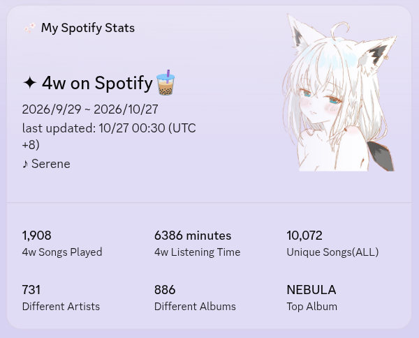
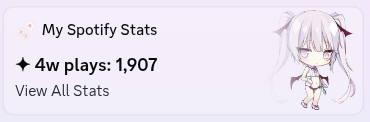

- **Profile widget:** last played song, plus six stats such as songs played,
  listening time, different artists, or top album, over 4 weeks or any range.
- **Admin page** (`/admin`): choose the six stats, their time ranges, and the
  widget text, then sync or send a test recap. No redeploy needed.
- **Recap DMs:** every Monday and on the 1st of each month, with your top
  songs, artists, albums, and listening habits.
- **History import:** load your full Spotify history export, so stats go back
  years.

> [!WARNING]
> **Can I still make a profile widget?** Discord ended its custom profile
> widget experiment on 2026-07-27. Widgets made during the experiment still
> update (this project's own widget does), but Discord now only gives the
> widget editor to apps with a
> [claimed game](https://docs.discord.com/developers/social-layer/game-stats-widgets/overview).
> You will see in [Step 6](#step-6-set-up-the-profile-widget) whether your app
> has it. Without a widget, everything else still works: stats, the admin page,
> and recap DMs.

## Contents

- [What you need](#what-you-need)
- [Setup, step by step](#setup-step-by-step)
- [Deploy from your computer instead](#deploy-from-your-computer-instead)
- [Choosing what the widget shows](#choosing-what-the-widget-shows)
- [What happens next](#what-happens-next)
- [Import your full Spotify history](#import-your-full-spotify-history-optional)
- [FAQ](#faq)
- [Troubleshooting](#troubleshooting)
- [Updating](#updating)
- [More docs](#more-docs)
- [For developers](#for-developers)

## What you need

- **Spotify Premium.** Since February 2026, Spotify requires Premium to use a
  developer app like the one you create here.
- **A Discord account** and a server where you can add a bot. Your own empty
  server works; creating one is free.
- **A free [Cloudflare](https://dash.cloudflare.com/sign-up) account.** This is
  where the project runs.
- **A free [GitHub](https://github.com/signup) account.** The Deploy button
  puts your own copy of the project there. A GitLab account also works.
- About 15 minutes.

You don't need Node.js or a terminal. Everything happens in the browser. (If
you would rather deploy from your own computer, see
[Deploy from your computer instead](#deploy-from-your-computer-instead).)

Along the way you will collect a few values. Keep a text file open and paste
them there as you go:

| Value | You get it in |
| --- | --- |
| Discord bot token (keep secret) | Step 1 |
| Admin password (keep secret, you make it up) | Step 2 |
| Spotify Client ID | Step 4 |
| Spotify Client Secret (keep secret) | Step 4 |

## Setup, step by step

The short version: create a Discord bot, click this button, then finish on
your admin page.

[](https://deploy.workers.cloudflare.com/?url=https://github.com/956zs/spotify-discord-stats)

### Step 1: Create a Discord app and bot

The profile widget belongs to this app, and its bot sends you the recap DMs.
Create it with your own Discord account: the Worker sends the DMs to, and
updates the widget of, the account that owns the app.

1. Go to the [Discord Developer Portal](https://discord.com/developers/applications)
   and click **New Application**. Its name is shown on the widget, for example
   `My Spotify Stats`.

   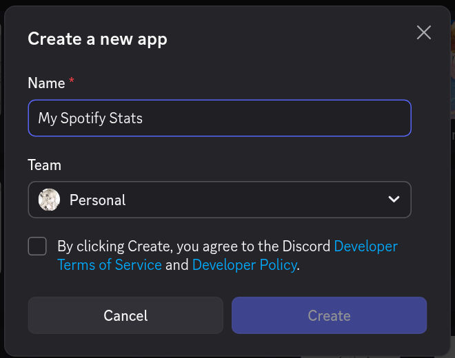

2. Open the **Bot** page, click **Reset Token**, and copy the token. Discord
   shows it only once. Treat it like a password.

   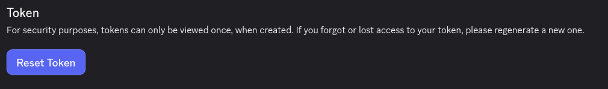
3. Add the bot to your server: open **OAuth2** → **URL Generator** and tick
   the `bot` scope. No permissions are needed. Open the generated link at the
   bottom, pick your server, then click **Continue** and **Authorize**.

   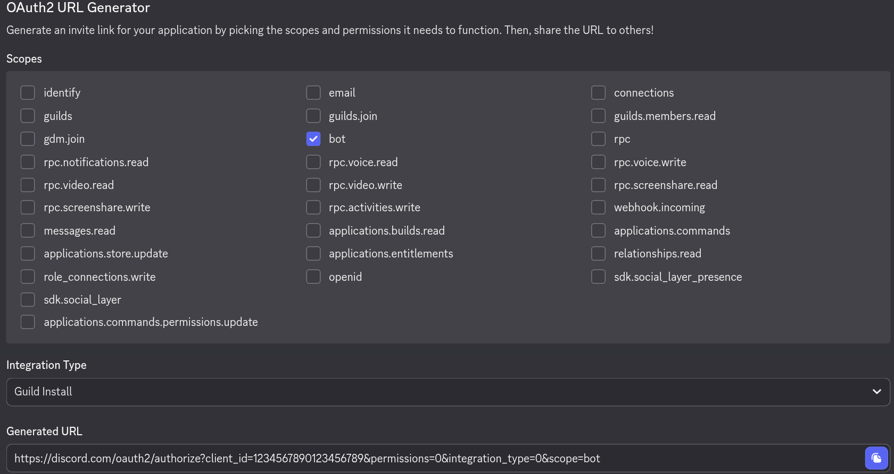

You don't need the Application ID or your user ID. The Worker reads both from
the bot token.

> [!NOTE]
> The bot can only DM you if you share a server with it and that server allows
> DMs from members (right-click the server → **Privacy Settings**).

### Step 2: Click Deploy to Cloudflare

1. Click the **Deploy to Cloudflare** button above.
2. Sign in to Cloudflare, and connect your GitHub account when asked.
   Cloudflare makes a copy of this project in your GitHub account and creates
   the database for you. You can keep the suggested names.
3. Cloudflare asks for two values:
   - `DISCORD_TOKEN`: the bot token from Step 1.
   - `ADMIN_TOKEN`: your admin password. Make up a long random string of at
     least 32 characters (a password manager can generate one). You use it to
     sign in to the admin page. Cloudflare never shows it again, so keep it
     somewhere safe.
4. Start the deploy and wait for it to finish. It sets up the database by
   itself.
5. Cloudflare shows your **Worker URL**, something like
   `https://spotify-discord-stats.your-name.workers.dev`. Copy it. You can
   also find it later in the Cloudflare dashboard under **Workers & Pages**.
   A brand-new `workers.dev` address can take a few minutes to start working.

### Step 3: Open the admin page

1. Open your Worker URL followed by `/admin`, for example
   `https://spotify-discord-stats.your-name.workers.dev/admin`.
2. Paste your admin password into the **ADMIN_TOKEN** box and click
   **Sign in**. The page follows your browser's language; use the **中文 / EN**
   switch in the header to change it.

   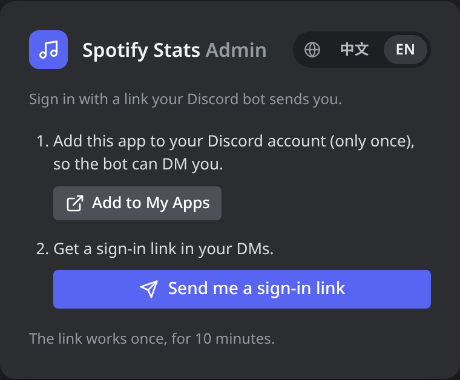

The page opens on the **Status** tab, because the Spotify app is not set up
yet. That is the next step. The **Discord app** line in the status list shows
your app ID and the user the DMs and widget go to; that should be you.

### Step 4: Create a Spotify app

The **Spotify app** panel at the top of the **Status** tab shows your
**Redirect URI**, with a **Copy** button. It is your Worker URL followed by
`/spotify/callback`.

1. Go to the [Spotify Developer Dashboard](https://developer.spotify.com/dashboard),
   log in, and click **Create app**.
2. Fill in:
   - **App name** and **App description**: anything, for example
     `My Spotify Stats`.
   - **Redirect URIs**: paste the Redirect URI from the admin page and click
     **Add**.
   - When asked which APIs you plan to use, tick **Web API**.

   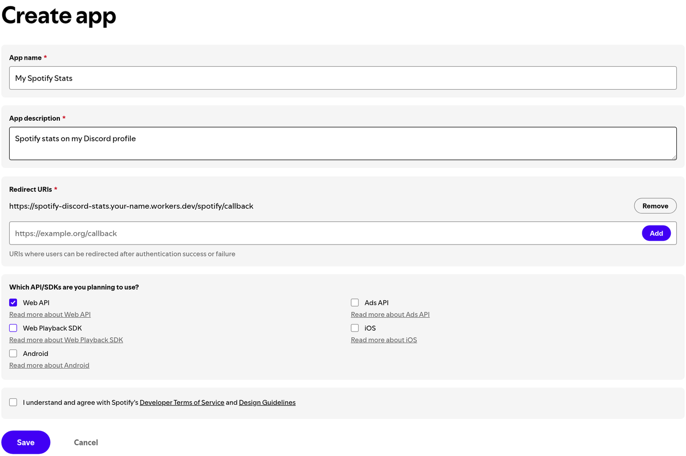
3. Accept the terms and click **Save**.
4. Open the app's **Settings**. Copy the **Client ID**, then click
   **View client secret** and copy the **Client Secret**.

   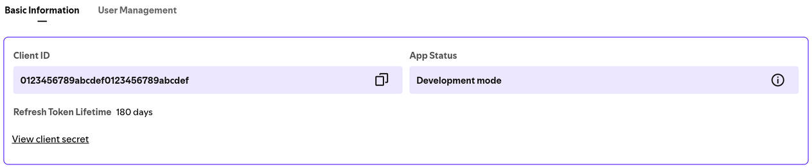
5. Back on the admin page, paste both into the **Spotify app** panel and click
   **Save and check**. The page checks the pair with Spotify before saving it,
   so a typo shows up right away.

> [!NOTE]
> The stats come from the Spotify account you sign in with in Step 5, not
> from the account that owns this app. They can be the same account. If they
> differ, add the account you will sign in with under **Settings** →
> **User Management** first.

### Step 5: Connect your Spotify account

On the **Status** tab, click **Reconnect Spotify**. (It stays greyed out until
the Spotify app is saved.) Spotify asks for permission to read your recently
played songs. Click **Agree**. You should see
**Spotify authorization complete**.

### Step 6: Set up the profile widget

Custom widgets come from a Discord experiment, so part of the setup uses
workarounds. chloecinders' guide [How to Make Discord Widgets](https://chloecinders.com/blog/discord-widgets) covers
them in detail. Follow it, with two shortcuts from this project:

1. In the [Discord Developer Portal](https://discord.com/developers/applications),
   open your app. In the left menu under **Games**, click **Widget**.

   > If there is no **Widget** item, Discord has not given your app the widget
   > editor (see the warning at the top). Skip to Step 7; everything except the
   > widget works.

2. **Shortcut 1:** instead of building the widget by hand, open
   [docs/discord-widget-config.json](docs/discord-widget-config.json) and copy
   all of it (on GitHub, use the **Copy raw file** button). In the widget
   editor, click the **⋮** button at the top right and choose
   **Paste config from clipboard**. This sets up every field with the right
   name.

   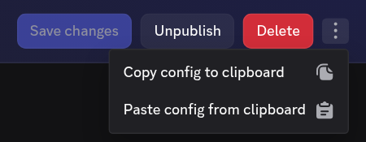

3. The widget shows three pictures. Upload your own images under **Games** →
   **Assets** with the names `widget_hero` (the big picture on the widget),
   `widget_preview`, and `widget_mini`, or pick other images in the editor.
4. Click **Save changes**, then **Publish**. Other people only see published
   widgets.
5. Apply the application identity and add the widget to your profile as the
   guide explains in [Adding the Widget to your Profile](https://chloecinders.com/blog/discord-widgets#displaying-the-widget-on-your-profile).
   **Shortcut 2:** you don't need to keep the guide's sample data up to date;
   the Worker sends your real stats every 10 minutes.

> [!CAUTION]
> Never paste your bot token into a website. The guide's Widget Identity
> Creator is a small app that runs on your own computer, so the token stays on
> your device.

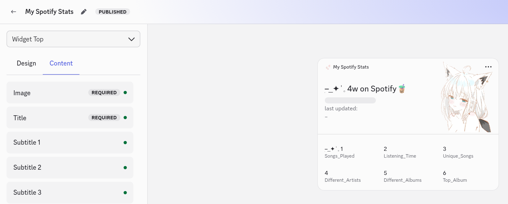

Field names and details: [docs/discord-widget.md](docs/discord-widget.md).

### Step 7: Check that it works

1. On the admin page's **Status** tab, click **Sync now**. Under
   **Last action result** you see **Fetched N plays, added N new** and whether
   the widget was updated. Reload the page to refresh the preview.

   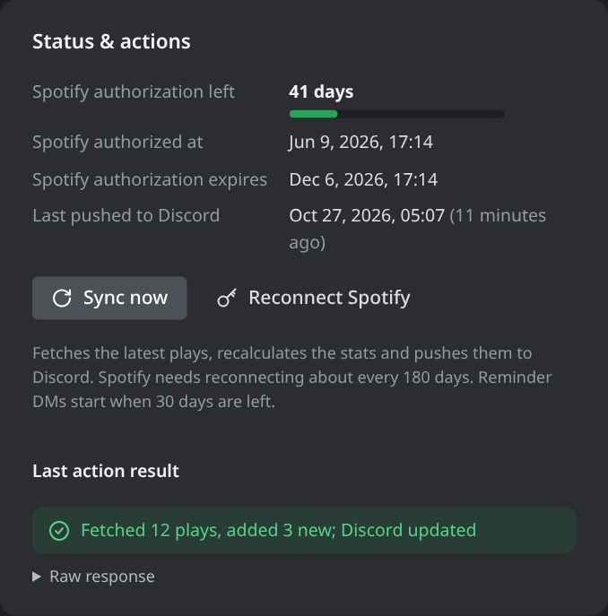
2. Your profile widget now shows your stats. If it does not change, reload
   Discord (`Ctrl+R`, or `Cmd+R` on macOS).
3. On the **Recaps** tab, click **Send weekly** and confirm. A recap DM from
   your bot arrives within a few seconds.

Done. Everything now runs on Cloudflare.

## Deploy from your computer instead

You can skip GitHub and the Deploy button and deploy from a terminal instead.
Do Step 1 first, then:

1. Install [Node.js](https://nodejs.org/) 24 or newer. After installing it,
   open a new terminal and run `node -v` to check that it prints `v24` or
   higher.
2. Download the project: click the green **Code** button on this page, then
   **Download ZIP**, and unzip it. Or, if you use git:

   ```bash
   git clone https://github.com/956zs/spotify-discord-stats.git
   ```

3. Open a terminal in the project folder:
   - **Windows:** open the folder in File Explorer, click the address bar, type
     `cmd`, and press Enter. Use this Command Prompt rather than PowerShell,
     which often blocks `npm` with a "running scripts is disabled" error.
   - **macOS:** right-click the folder in Finder and choose **Services** →
     **New Terminal at Folder**.
   - **Linux:** open a terminal and `cd` into the folder.
4. Install what it needs, and log in to Cloudflare. A browser window opens;
   click **Allow**.

   ```bash
   npm install
   npx wrangler login
   ```

5. Put the project online. This creates the Worker and its database. The
   first time, it asks a few questions, such as a `workers.dev` subdomain for
   your first Worker; any available name works. If it asks you to confirm,
   type `y` and press Enter.

   ```bash
   npm run deploy
   ```

   It prints your **Worker URL**. Copy it. A brand-new address can take a few
   minutes to start working.
6. Save the bot token and your admin password (see Step 2) in Cloudflare. Run
   each command, then paste the value when it asks and press Enter. Nothing
   appears while you paste; that is normal.

   ```bash
   npx wrangler secret put DISCORD_TOKEN
   npx wrangler secret put ADMIN_TOKEN
   ```

7. Continue with [Step 3](#step-3-open-the-admin-page).

The first deploy prints `Creating new D1 Database` and then sets up the
database tables. Later deploys find the same database by its name.

## Choosing what the widget shows

The admin page's **Widget** tab sets the stats range (7, 28, 90, 365 days, any
number of days, or all time), the widget text, and what each of the six stat
slots shows, with a live preview on the right. Changes apply at the next sync,
or right away with **Save & push to Discord** at the bottom of the page.

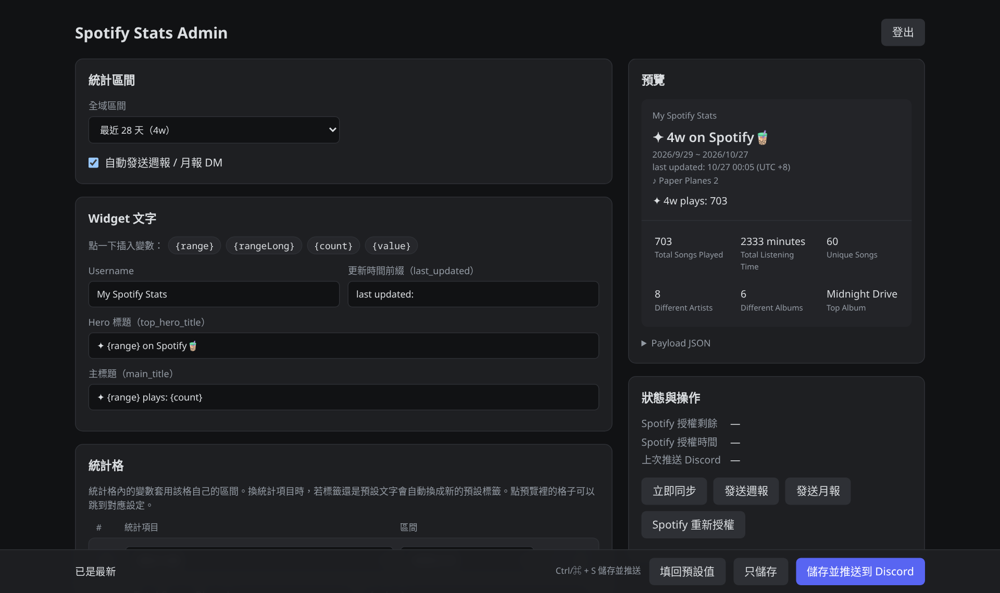

Each slot picks a stat and its own range; the preview updates as you change
them. Here slot 3 shows the top artist of all time:

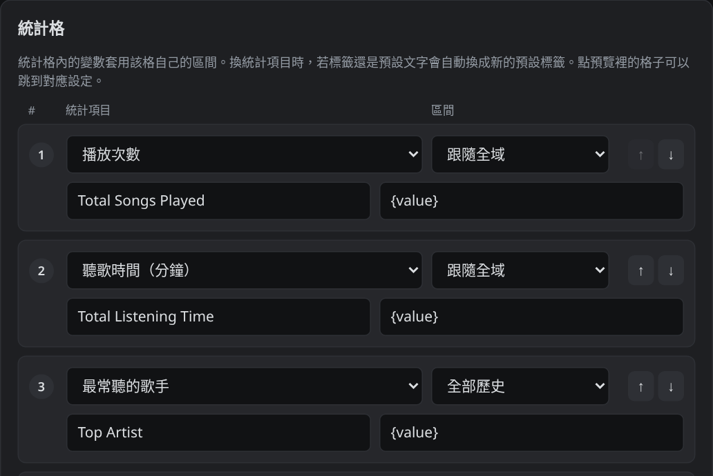
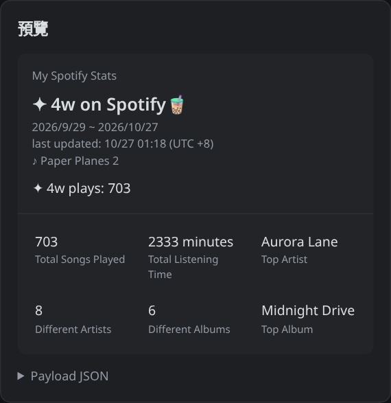

The big image at the top of the widget can be a fixed picture (the
`widget_hero` asset, the default), an image you upload on the admin page, or
the album cover of the song you played last. Pick one on the **Hero image** tab.
If you set up your widget before this option existed, open the widget editor
and change the hero image to User Data `hero_image` with `widget_hero` as the
Fallback, or paste [the config](docs/discord-widget-config.json) again.
Discord may keep showing the old picture for a while.
**Choose & crop an image** opens a crop tool that cuts your picture to exactly
1300×1200, with guides showing which parts fade out or sit under the text.

Every setting and stat is listed in [docs/admin-page.md](docs/admin-page.md).

## What happens next

- Every 10 minutes, the Worker reads your last 50 played songs from Spotify,
  saves new ones, and updates the widget when the numbers change. Spotify only
  keeps a short recent history, so songs from before you set this up are
  missing until you
  [import your history](#import-your-full-spotify-history-optional).
- **Weekly recap:** every Monday at 09:00, covering the last 7 days.
- **Monthly recap:** on the 1st of each month at 09:00, covering the previous
  month.
- Recap times use Taiwan time (UTC+8). The time zone is not configurable yet.
- Spotify connections are assumed to last about 180 days. From 30 days before
  that, the bot DMs you a reminder once a day with a link to reconnect. If
  syncing starts failing earlier, reconnect with **Reconnect Spotify** on the
  admin page's **Status** tab.

Each recap is a few DM cards: totals and comparison with the previous period,
rankings, album covers with listening patterns, and new songs and artists.

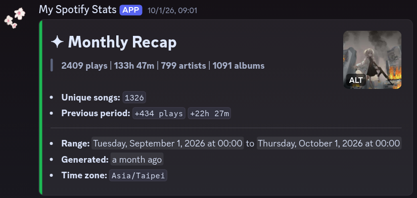
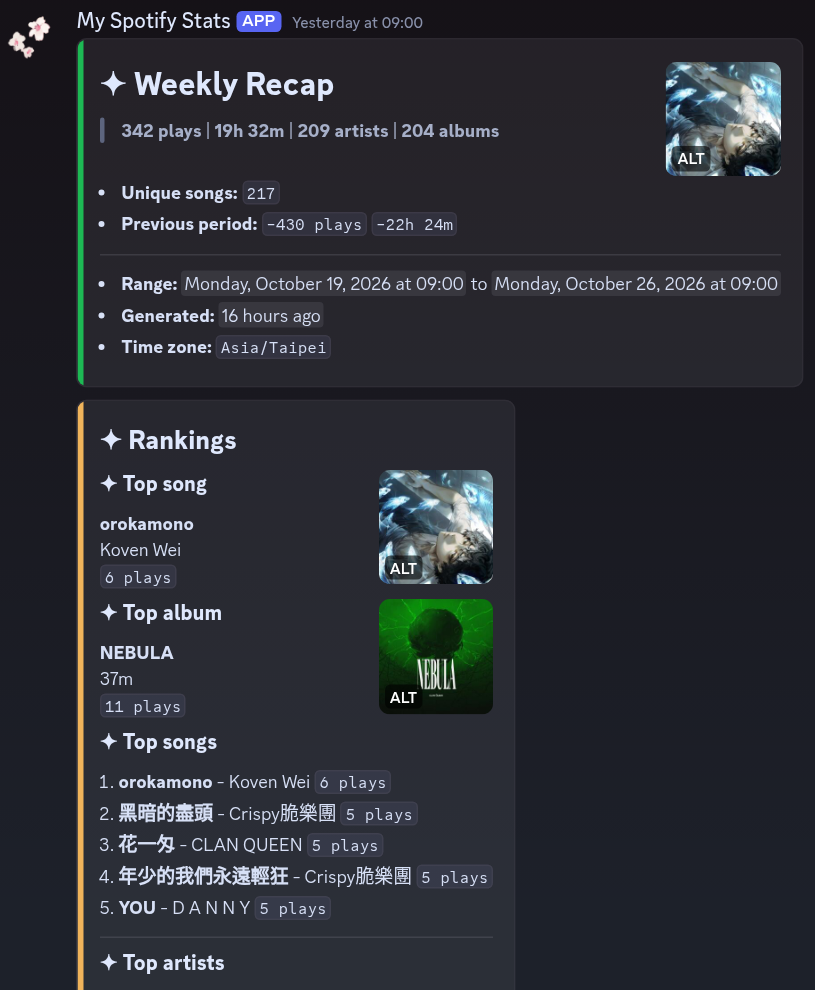
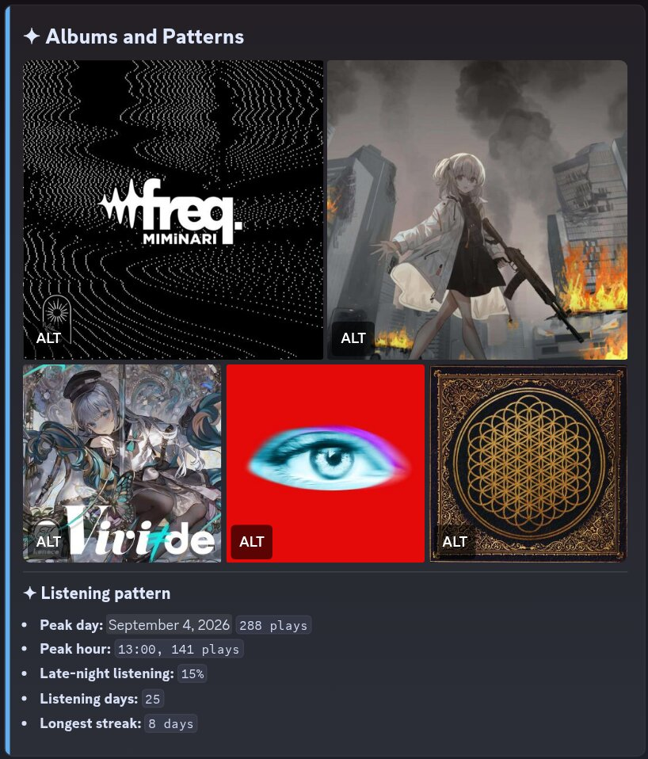

Recaps can be turned off on the admin page: on the **Recaps** tab, switch off
**Send weekly / monthly recap DMs automatically**, then click **Save only**.

## Import your full Spotify history (optional)

Spotify can send you everything you have ever played. Importing it needs a
computer with Node.js: do steps 1 to 4 of
[Deploy from your computer instead](#deploy-from-your-computer-instead) (if
you used the Deploy button, download your own copy of the project from your
GitHub account rather than this one), but don't run `npm run deploy`.

1. Go to your [Spotify privacy settings](https://www.spotify.com/account/privacy/)
   and request **Extended streaming history**. Spotify emails it to you,
   usually within a few days and at most 30.
2. Unzip the download.
3. Back up the database, check the import without writing anything, then
   import. Put the folder path in quotes; you can drag the folder into the
   terminal window to paste its path.

   ```bash
   npm run cf:d1:backup:remote
   npm run cf:import -- --remote --dry-run "/path/to/Spotify Extended Streaming History"
   npm run cf:import -- --remote "/path/to/Spotify Extended Streaming History"
   ```

4. On the admin page's **Status** tab, click **Sync now** to refresh the
   numbers.

The import skips everything played after your first synced song, so plays
already saved by the Worker are not counted twice, and running the same import
again does not add anything. The shorter "Account data" export also works, but
it has less detail. To undo an import, see
[docs/backup-rollback-and-import.md](docs/backup-rollback-and-import.md).

## FAQ

<details>
<summary><b>I can't find Create app on the Spotify Developer Dashboard</b></summary>

- **No Premium.** Since February 2026, free Spotify accounts can't create
  developer apps. The dashboard then only says "You haven't created any apps
  yet", with no button at all.
- **Premium Duo or Family member.** Users report that only the plan manager's
  account counts as Premium here; member accounts get the same empty
  dashboard. Ask the plan manager to create the app (see the workaround below).
- **Email not verified.** The dashboard says "You need to verify your email
  address before you can create an app". Verify the email on your Spotify
  account. If you sign in with Google, Facebook, or Apple, you may not get the
  verification email; add an email-and-password sign-in under
  [Login methods](https://www.spotify.com/account/login-methods/) first.
- **You already have an app.** Spotify limits how many apps you can create.
  You can reuse an app you already have: add this project's Redirect URI to it.
- Some Premium accounts still don't see the button; that is on Spotify's side.
  Ask on the [Spotify for Developers forum](https://community.spotify.com/t5/Spotify-for-Developers/bd-p/Spotify_Developer).

**Workaround without Premium:** Spotify only requires the app's owner to have
Premium. Someone with Premium (a friend, or your plan manager) can add your
Spotify email to their app under **User Management** (up to 5 users per app),
add your Redirect URI (from your admin page) to its Redirect URIs, and give you
the app's Client ID and Client Secret. In Step 5, connect your own Spotify
account (sign out of theirs first): the Worker records whichever account you
connect, not the app owner's. Only do this with people you trust: whoever has
the Client Secret can act as that app, and the app stops working if the owner's
Premium lapses.
</details>

<details>
<summary><b>Does it cost anything?</b></summary>

No. It runs within Cloudflare's free plan (Workers, Cron Triggers, and D1).
You only need Spotify Premium, which Spotify requires for developer apps.
</details>

<details>
<summary><b>Do I need my own domain?</b></summary>

No. The free `workers.dev` address works. To use your own domain, add it to
Cloudflare, uncomment `routes` in `wrangler.toml` (on your GitHub copy if you
used the Deploy button), and deploy again. Then open the admin page on the new
address and add the Redirect URI it shows to your Spotify app.
</details>

<details>
<summary><b>Can I still create a new profile widget?</b></summary>

Probably not: Discord ended the custom widget experiment on 2026-07-27 and new
apps don't get the widget editor. See the warning at the top. Recap DMs, stats,
and the admin page work without a widget.
</details>

<details>
<summary><b>Can my friends use my setup?</b></summary>

No. One setup follows one Spotify account and updates one Discord user's
profile. Each friend sets up their own copy with their own Discord app,
Spotify app, and Cloudflare account.
</details>

<details>
<summary><b>Does the widget show what I'm playing right now?</b></summary>

No. It shows the last song you finished, checked every 10 minutes. Discord
widgets aren't meant for live data.
</details>

<details>
<summary><b>Why doesn't my listening time match Spotify Wrapped?</b></summary>

Spotify's Recently Played list gives each song's length, not how long you
actually listened, so synced listening time counts whole songs. Imported
history has the exact play time.
</details>

<details>
<summary><b>Can I change when the recaps arrive?</b></summary>

Yes, by editing `recapReports` in [config/app.json](config/app.json) and
deploying again: `weeklyDay` (0 = Sunday, 1 = Monday, ...), `monthlyDay`,
`sendHour`, and `sendMinute` (a multiple of 10). Times are in Taiwan time
(UTC+8); the time zone itself can't be changed yet. If you used the Deploy
button, edit the file in your GitHub copy; saving it there deploys again.
</details>

<details>
<summary><b>Who can see my data?</b></summary>

Your plays, your Spotify connection, and your Spotify app's Client Secret are
stored in your own Cloudflare database. The admin page and its routes need
your admin password. Spotify only lets the Worker read your recently played
songs. Anyone who opens your Discord profile sees what the widget shows.
</details>

<details>
<summary><b>How do I remove everything?</b></summary>

1. In the [Cloudflare dashboard](https://dash.cloudflare.com/), delete the
   Worker (under **Workers & Pages**) and its D1 database. From a terminal in
   the project folder, `npx wrangler delete` removes the Worker.
2. If you used the Deploy button, delete your copy of the project on GitHub.
3. Remove the app's access at [spotify.com/account/apps](https://www.spotify.com/account/apps/)
   and delete the app in the Spotify Developer Dashboard.
4. Remove the widget from your Discord profile, then delete the app in the
   Discord Developer Portal.
</details>

## Troubleshooting

To change a secret such as `DISCORD_TOKEN` or `ADMIN_TOKEN`, open your Worker
in the Cloudflare dashboard → **Settings** → **Variables and Secrets**, or run
`npx wrangler secret put NAME` from the project folder.

<details>
<summary><b>Spotify says <code>INVALID_CLIENT: Invalid redirect URI</code></b></summary>

The Redirect URI in the Spotify dashboard must match the one on your admin
page exactly, including `https://` and with no trailing slash. To see it again,
click **Change** on the **Spotify app** panel of the **Status** tab (then
**Cancel**). The Redirect URI follows the address you open the admin page on;
if you use more than one address (for example `workers.dev` and your own
domain), add each one's Redirect URI to the Spotify app.
</details>

<details>
<summary><b>Save and check says the Client ID or Client Secret is wrong</b></summary>

Copy both again from the Spotify app's **Settings**. Each is 32 letters and
digits.
</details>

<details>
<summary><b>Sync fails with <code>Active premium subscription required</code> or a 403 error from Spotify</b></summary>

The Spotify account that owns the app needs an active Premium subscription. If
you connected a different Spotify account, add it under **User Management**
in the Spotify app settings.
</details>

<details>
<summary><b>The widget does not update, or the admin page warns that the widget push failed</b></summary>

- Check that the widget is on your profile (Step 6) and that it belongs to the
  same Discord app as the bot token. The **Discord app** line on the
  **Status** tab shows that app's ID.
- After a sync, the admin page shows the reason as a yellow warning under
  **Last action result** on the **Status** tab; plays are still saved and
  recaps still go out.

  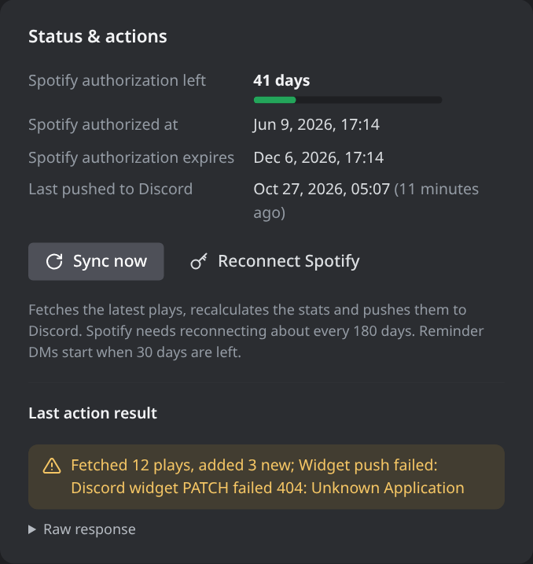

- If your app has no widget editor, you can't have a widget right now (see
  the warning at the top). To stop the Worker from trying, set
  `"patchDiscordOnSync": false` in `config/app.json` and deploy again.
- More in [docs/discord-widget.md](docs/discord-widget.md).
</details>

<details>
<summary><b>No recap DM arrives</b></summary>

- Make sure the bot is in a server you are also in.
- In that server, allow DMs from members (right-click the server →
  **Privacy Settings**).
- Check the **Discord app** line on the **Status** tab. It shows the user the
  DMs go to. That is the owner of the Discord app (for an app that belongs to
  a team, the team owner). To send them to someone else, set
  `DISCORD_USER_ID` (DMs and widget) or `DISCORD_REMINDER_USER_ID` (DMs only),
  see [docs/cloudflare-worker.md](docs/cloudflare-worker.md#optional-settings).
- If that line says **Could not read the app from the bot token**, the bot
  token is wrong or was reset. Resetting it in the Developer Portal
  invalidates the old one; save the new one as `DISCORD_TOKEN`.
</details>

<details>
<summary><b>The admin page rejects my password (<code>Wrong token</code>)</b></summary>

The password does not match `ADMIN_TOKEN`. If you lost it, set a new one as
`ADMIN_TOKEN`.
</details>

## Updating

Your secrets, settings, and data are kept when you update. Every deploy also
applies new database changes first.

**If you used the Deploy button:** your project lives in your own GitHub copy,
which Cloudflare deploys again each time it changes (Workers Builds). Bring in
the new version there:

- If your copy is a fork of this project, open it on GitHub and click
  **Sync fork**.
- If it is a plain copy (no **Sync fork** button), pull the changes from this
  project with git and push them to your copy:

  ```bash
  git pull https://github.com/956zs/spotify-discord-stats.git main
  git push
  ```

Pushing to your copy starts a new build and deploy. You can follow it on your
Worker's page in the Cloudflare dashboard.

**If you deployed from your computer:** download the new version (or
`git pull`), then run:

```bash
npm install
npm run deploy
```

If you made a `wrangler.local.toml` and downloaded a ZIP, copy it from the old
folder into the new one.

### Upgrading an existing setup

If you set this up before the Deploy button existed, there is nothing to
change: values you set in Cloudflare (the `[vars]` in your `wrangler.toml` and
your secrets) keep working and always win over the values the Worker finds by
itself. The **Spotify app** panel then says that the app is set in Cloudflare.

The project now ships its own `wrangler.toml`, so your untracked one would
block `git pull`. Rename yours to `wrangler.local.toml` first; all the npm
scripts use `wrangler.local.toml` when it exists. Then:

```bash
git pull
npm install
npm run deploy
```

ZIP users: copy your old `wrangler.toml` into the new folder as
`wrangler.local.toml`.

## More docs

- [Admin page](docs/admin-page.md): every setting, stat, and admin route.
- [Discord profile widget](docs/discord-widget.md): field names and how the
  widget is updated.
- [Cloudflare Worker deployment](docs/cloudflare-worker.md): the setup above
  in reference form, with every setting you can override.
- [Backup, rollback, and history import](docs/backup-rollback-and-import.md)
- [Running on your own server](docs/vps-deployment.md): a Node.js + SQLite
  alternative to Cloudflare. It does not send scheduled recaps.
- [Recap glossary](docs/recap-glossary.md) and
  [ADR 0001](docs/adr/0001-discord-recap-reports.md): how recap reports are
  designed.

## For developers

Project layout:

- `worker/`: the Cloudflare Worker (routes, D1 access, Spotify, Discord,
  stats, recap delivery).
- `shared/`: runtime-neutral helpers (time, keys, play parsing, metrics,
  recap rendering).
- `src/`: Node.js + SQLite runtime for local development and the VPS option.
- `scripts/`: deploy, Wrangler wrapper, D1 backup, and history import tools.
- `migrations/`: D1 schema migrations.
- `config/`: default app and widget settings.
- `test/`: Node test suite.

Run the tests and a syntax check:

```bash
npm test
find src worker shared scripts test -name '*.js' -print0 | xargs -0 -n 1 node --check
```

The shipped [wrangler.toml](wrangler.toml) has no IDs, so it works with the
Deploy button as is. Put a personal config (account ID, your own domain,
database ID, `[vars]`) in `wrangler.local.toml` (gitignored), starting from a
copy of `wrangler.toml`. Every npm script that runs Wrangler (`npm run deploy`,
`cf:dev`, `cf:d1:migrate:*`, `cf:d1:backup:*`, `cf:import`) uses it when it
exists; `npm run cf -- <wrangler args>` runs any other Wrangler command the
same way. The D1 scripts address the database by its binding name `DB`.
`npm run deploy` applies migrations and then deploys; when the database does
not exist yet, it deploys first so Wrangler creates it, then migrates.

To run the Worker locally, copy [.dev.vars.example](.dev.vars.example) to
`.dev.vars` and fill in `DISCORD_TOKEN` and `ADMIN_TOKEN`. Enter the Spotify
app on the admin page, or put `SPOTIFY_CLIENT_ID` and `SPOTIFY_CLIENT_SECRET`
in `.dev.vars`. Then apply the migrations to a local database and start it:

```bash
npm run cf:d1:migrate:local
npm run cf:dev
```

The Node/SQLite commands (`npm run spotify:auth-url`, `spotify:token`,
`spotify:sync`, `npm start`) read `.env`; copy
[node.env.example](node.env.example) to `.env` to get started. That runtime
finds nothing by itself: fill in the Discord and Spotify values there.

Known limitations:

- Recap schedules use `Asia/Taipei`.
- Spotify's Recently Played API returns track length, not time actually
  listened, so listening time from synced plays is an estimate. Imported
  history has exact play time.
- Spotify history exports do not include album artwork.

## License

[MIT](LICENSE)
