# Spotify Discord Stats

[English](README.md) | 繁體中文

把你的 Spotify 聽歌統計放到 Discord 個人檔案上。一個小小的 Cloudflare Worker 每 10 分鐘
檢查你聽了什麼，更新個人檔案上的 widget：最近播放的歌，加上你自選的六項統計。
它也會每週、每月用 Discord 私訊寄一份聽歌回顧給你。整套免費跑在 Cloudflare 上，
不需要自己的伺服器。


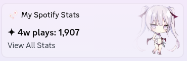

- **個人檔案 widget**：最近播放的歌，加上六項統計，例如播放次數、聽歌時間、歌手數、
  最常聽的專輯，區間可以是 4 週或任何長度。
- **admin 頁**（`/admin`）：選六項統計、各自的區間和 widget 文字，也能立即同步或寄測試回顧。
  不用重新部署。
- **回顧私訊**：每週一和每月 1 號寄出，內容有最常聽的歌、歌手、專輯和聽歌習慣。
- **匯入歷史**：匯入 Spotify 提供的完整歷史紀錄，統計能往回算好幾年。

> [!WARNING]
> **現在還能做個人檔案 widget 嗎？** Discord 在 2026-07-27 結束了自訂個人檔案 widget
> 的實驗。實驗期間做好的 widget 目前還會更新（這個專案自己的就是），但 Discord 現在只把
> widget 編輯器開放給[認領過遊戲](https://docs.discord.com/developers/social-layer/game-stats-widgets/overview)
> 的 app。你的 app 有沒有這個功能，到[第 7 步](#第-7-步設定個人檔案-widget)就會知道。
> 就算沒有 widget，其他功能都照常能用：統計、admin 頁和回顧私訊。

## 目錄

- [需要準備什麼](#需要準備什麼)
- [一步一步設定](#一步一步設定)
- [選擇 widget 要顯示什麼](#選擇-widget-要顯示什麼)
- [設定完之後](#設定完之後)
- [匯入完整的 Spotify 歷史（選用）](#匯入完整的-spotify-歷史選用)
- [常見問題](#常見問題)
- [疑難排解](#疑難排解)
- [更新版本](#更新版本)
- [更多文件](#更多文件)
- [給開發者](#給開發者)

## 需要準備什麼

- **Spotify Premium。** 從 2026 年 2 月起，Spotify 規定要有 Premium 才能使用開發者 app
  （也就是這裡要建立的那種）。
- **Discord 帳號**，以及一個你有權限加 bot 的伺服器。自己開一個空的伺服器就行，免費。
- **免費的 [Cloudflare](https://dash.cloudflare.com/sign-up) 帳號。** 程式就跑在這裡。
- **電腦上裝好 [Node.js](https://nodejs.org/) 24 以上**，只有設定時會用到。裝好之後開一個
  新的終端機，執行 `node -v`，確認印出來的是 `v24` 或更新的版本。
- 大約 30 分鐘。

接下來要在專案資料夾裡開終端機貼指令：

- **Windows**：用檔案總管打開資料夾，點一下網址列，輸入 `cmd` 按 Enter。請用這個命令提示字元，
  不要用 PowerShell，它常常會擋下 `npm`，出現「已停用指令碼執行」的錯誤。
- **macOS**：在 Finder 對資料夾按右鍵，選 **服務** → **新增位於檔案夾位置的終端機視窗**。
- **Linux**：開終端機，`cd` 到資料夾裡。

過程中會拿到幾個值。建議開一個記事本，邊做邊貼進去：

| 值 | 在哪一步拿到 |
| --- | --- |
| Discord Application ID | 第 2 步 |
| Discord bot token（不能外流） | 第 2 步 |
| 你的 Discord 使用者 ID | 第 2 步 |
| 資料庫 ID | 第 3 步 |
| 你的 Worker 網址 | 第 3 步 |
| Spotify Client ID | 第 4 步 |
| Spotify Client Secret（不能外流） | 第 4 步 |
| 管理密碼（不能外流，自己想一個） | 第 5 步 |

## 一步一步設定

### 第 1 步：下載專案

在這個頁面按綠色的 **Code** 按鈕，選 **Download ZIP**，再解壓縮。會用 git 的話也可以：

```bash
git clone https://github.com/956zs/spotify-discord-stats.git
```

在專案資料夾裡開終端機（見[需要準備什麼](#需要準備什麼)），安裝需要的套件：

```bash
npm install
```

### 第 2 步：建立 Discord app 和 bot

個人檔案 widget 屬於這個 app，回顧私訊則由它的 bot 寄給你。

1. 打開 [Discord Developer Portal](https://discord.com/developers/applications)，
   按 **New Application**。名字會顯示在 widget 上，例如 `My Spotify Stats`。

   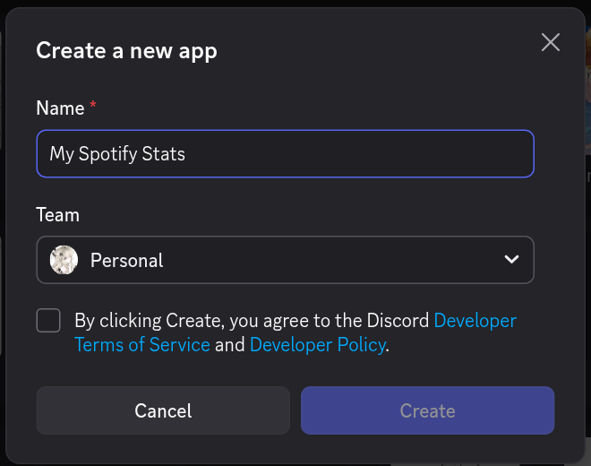

2. 在 **General Information** 頁面複製 **Application ID**。

   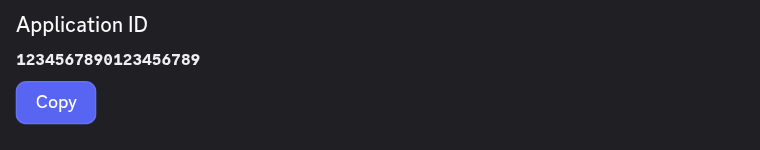
3. 打開 **Bot** 頁面，按 **Reset Token**，複製 token。這個 token 只會顯示一次，
   請當成密碼保管。

   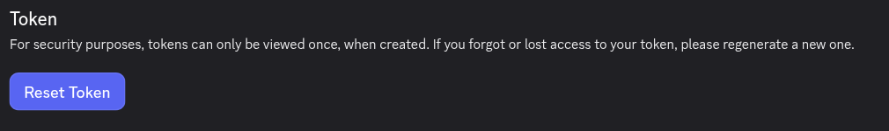
4. 把 bot 加進你的伺服器：打開 **OAuth2** → **URL Generator**，勾選 `bot`，
   權限不用勾。打開最下面產生的連結，選你的伺服器，按 **繼續**，再按 **授權**。

   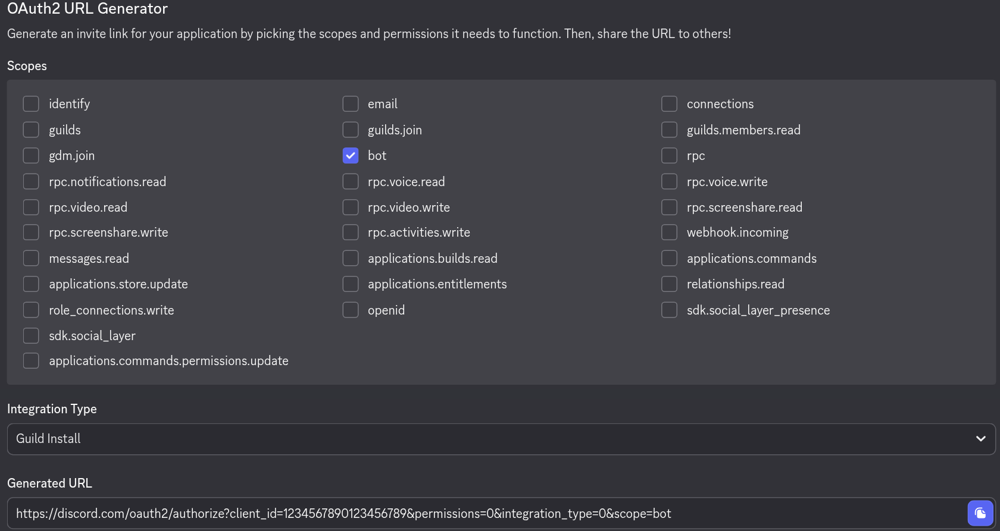
5. 取得你自己的使用者 ID：在 Discord 打開 **使用者設定**（齒輪圖示）→ **進階**，
   開啟 **開發者模式**。接著在任何地方對自己的名字按右鍵，選 **複製使用者 ID**。

> [!NOTE]
> bot 要跟你在同一個伺服器裡，而且那個伺服器允許成員傳私訊給你（對伺服器按右鍵 →
> **隱私設定**），bot 才能私訊你。

### 第 3 步：設定 Cloudflare

1. 從終端機登入 Cloudflare。瀏覽器會跳出視窗，按 **Allow**。

   ```bash
   npx wrangler login
   ```

2. 複製範例檔，做出你自己的設定檔。Windows 請把 `cp` 換成 `copy`，
   或直接在檔案總管裡複製再改名。

   ```bash
   cp wrangler.example.toml wrangler.toml
   ```

3. 建立資料庫：

   ```bash
   npm run cf:d1:create
   ```

   它會印出一個 `database_id`，是一長串像 `1a2b3c4d-...` 的 ID，把它複製起來。
4. 用純文字編輯器打開 `wrangler.toml`（Windows 用記事本；macOS 請用 VS Code 這類程式編輯器，
   因為「文字編輯」會把 `"` 換成彎引號）。把 ID 貼到
   `database_id = "paste-database-id-here"` 的位置，存檔。
5. 建立資料表，然後第一次把專案部署上線。如果指令要你確認，輸入 `y` 按 Enter。

   ```bash
   npm run cf:d1:migrate:remote
   npm run cf:deploy
   ```

   如果這是你的第一個 Worker，Wrangler 會請你取一個 `workers.dev` 子網域，
   取一個還沒被用過的名字就好。新的網址可能要等幾分鐘才會生效。
6. 部署完會印出你的 **Worker 網址**，長得像
   `https://spotify-discord-stats.your-name.workers.dev`，把它複製起來。

### 第 4 步：建立 Spotify app

1. 打開 [Spotify Developer Dashboard](https://developer.spotify.com/dashboard)，
   登入後按 **Create app**。
2. 填寫：
   - **App name** 和 **App description**：隨便填，例如 `My Spotify Stats`。
   - **Redirect URIs**：你的 Worker 網址後面加上 `/spotify/callback`，例如
     `https://spotify-discord-stats.your-name.workers.dev/spotify/callback`，
     然後按 **Add**。
   - 問你打算用哪些 API 時，勾選 **Web API**。

   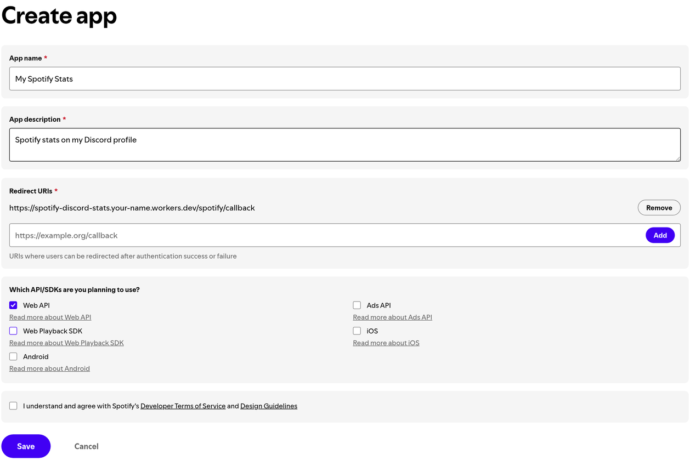
3. 同意條款，按 **Save**。
4. 打開這個 app 的 **Settings**，複製 **Client ID**，再按 **View client secret**
   複製 **Client Secret**。

   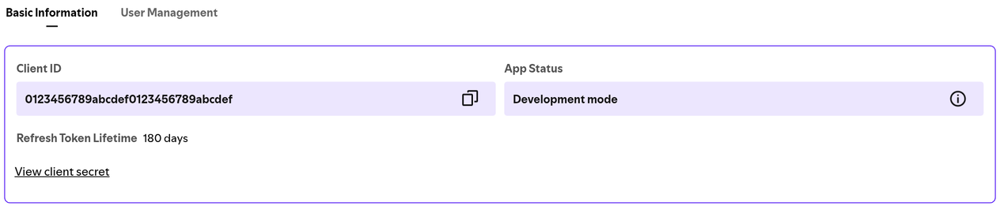

> [!NOTE]
> 統計的是第 6 步連結時登入的那個 Spotify 帳號，不是建立這個 app 的帳號。兩個可以是同一個；
> 如果不同，要先到 **Settings** → **User Management** 把你要登入的那個帳號加進去。

### 第 5 步：填入設定

1. 再打開 `wrangler.toml`，把你的值填進 `[vars]` 區塊，引號要保留：

   ```toml
   [vars]
   DISCORD_CLIENT_ID = "你的 Discord Application ID"
   DISCORD_USER_ID = "你的 Discord 使用者 ID"
   SPOTIFY_CLIENT_ID = "你的 Spotify Client ID"
   SPOTIFY_REDIRECT_URI = "https://spotify-discord-stats.your-name.workers.dev/spotify/callback"
   PUBLIC_BASE_URL = "https://spotify-discord-stats.your-name.workers.dev"
   ```

2. 自己想一組管理密碼：至少 32 個字元的隨機字串（可以用密碼管理器產生）。
   之後登入 admin 頁要用它。
3. 把三個機密值存進 Cloudflare。每個指令執行後，貼上對應的值再按 Enter。
   貼上時畫面上不會出現任何字，這是正常的。

   ```bash
   npx wrangler secret put DISCORD_TOKEN
   npx wrangler secret put SPOTIFY_CLIENT_SECRET
   npx wrangler secret put ADMIN_TOKEN
   ```

   `DISCORD_TOKEN` 是 bot token，`SPOTIFY_CLIENT_SECRET` 是 Spotify Client Secret，
   `ADMIN_TOKEN` 是你的管理密碼。存進去之後 Cloudflare 不會再顯示，管理密碼請自己保存好。
4. 再部署一次，讓新設定生效：

   ```bash
   npm run cf:deploy
   ```

### 第 6 步：連結你的 Spotify 帳號

1. 打開你的 Worker 網址加上 `/admin`，例如
   `https://spotify-discord-stats.your-name.workers.dev/admin`。
2. 在 **ADMIN_TOKEN** 欄位貼上管理密碼，按 **登入**。

   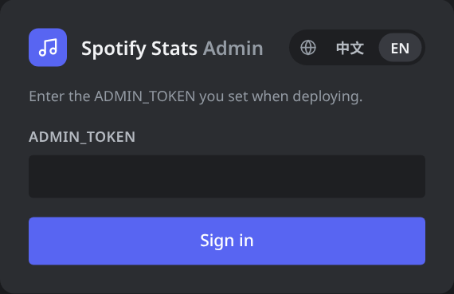
3. 按 **Spotify 重新授權**。Spotify 會詢問是否允許讀取你最近播放的歌曲，按 **Agree**。
   看到 **Spotify authorization complete** 就完成了。

### 第 7 步：設定個人檔案 widget

自訂 widget 來自 Discord 的實驗功能，所以有一部分設定要用變通的方法。chloecinders 的教學
[How to Make Discord Widgets](https://chloecinders.com/blog/discord-widgets)（英文）講得很完整，照著它做，再搭配這個專案的兩個捷徑：

1. 在 [Discord Developer Portal](https://discord.com/developers/applications)
   打開你的 app，在左邊選單的 **Games** 底下點 **Widget**。

   > 如果沒有 **Widget** 這個選項，代表 Discord 沒有開放 widget 編輯器給你的 app
   > （見最上面的警告）。直接跳到第 8 步，除了 widget 以外都能用。

2. **捷徑 1**：不用自己一格一格建，打開
   [docs/discord-widget-config.json](docs/discord-widget-config.json)，
   把內容全部複製起來（在 GitHub 上可以按 **Copy raw file** 按鈕）。在 widget 編輯器右上角按
   **⋮**，選 **Paste config from clipboard**。所有欄位會一次設定好，名稱也都對。

   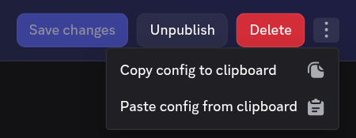

3. widget 上有三張圖。到 **Games** → **Assets** 上傳你自己的圖片，分別命名為
   `widget_hero`（widget 上的大圖）、`widget_preview` 和 `widget_mini`，
   或是在編輯器裡改選別的圖。
4. 按 **Save changes**，再按 **Publish**。沒有發佈的 widget 別人看不到。
5. 照教學的 [Adding the Widget to your Profile](https://chloecinders.com/blog/discord-widgets#displaying-the-widget-on-your-profile) 段落，
   套用 application identity，並把 widget 加到你的個人檔案。
   **捷徑 2**：教學裡的範例資料不用自己維護，Worker 每 10 分鐘會送你真正的統計上去。

> [!CAUTION]
> 不要把 bot token 貼到任何網站上。教學裡的 Widget Identity Creator 是在你自己電腦上執行的小程式，
> token 不會離開你的裝置。


欄位名稱和細節：[docs/discord-widget.md](docs/discord-widget.md)（英文）。

### 第 8 步：確認有在運作

1. 在 admin 頁按 **立即同步**。按鈕下方會顯示 **抓到 N 筆、新增 N 筆**，以及 widget
   有沒有更新。重新整理頁面就能看到最新的預覽。

   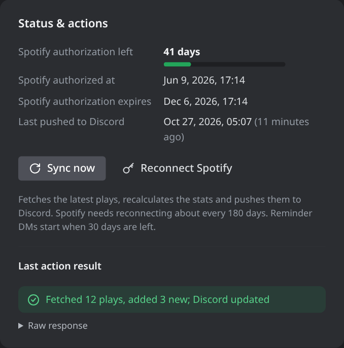
2. 你的個人檔案 widget 現在會顯示統計。如果沒變，重新整理 Discord（`Ctrl+R`，
   macOS 是 `Cmd+R`）。
3. 按 **發送週報**，按確定。幾秒內你應該會收到 bot 寄來的週報私訊。

大功告成。終端機可以關掉了，之後全部在 Cloudflare 上自動執行。

## 選擇 widget 要顯示什麼

admin 頁可以設定統計區間（7、28、90、365 天、自訂天數或全部時間）、widget 文字，
以及六個統計格各自顯示什麼，旁邊有即時預覽。改完會在下次同步時套用，或按
**儲存並推送到 Discord** 立刻更新。


每個統計格可以選統計項目和自己的區間，預覽會跟著即時更新。下圖把第 3 格改成全部歷史裡最常聽的歌手：

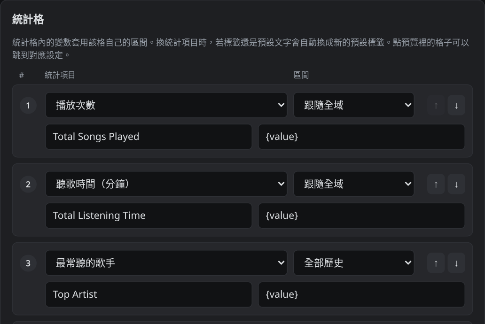
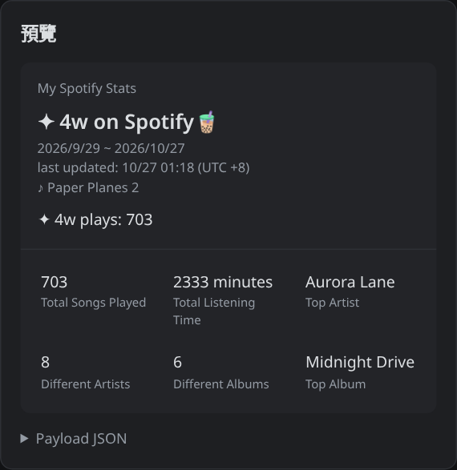

widget 最上面的大圖可以在 **Widget 大圖** 選：固定素材（`widget_hero`，預設）、
在 admin 頁上傳的圖片，或最近播放那首歌的專輯封面。如果你的 widget 是在這個選項出現之前做的，
要到 widget 編輯器把大圖改成 User Data `hero_image`，Fallback 選 `widget_hero`，
或重新貼一次 [設定檔](docs/discord-widget-config.json)。Discord 可能會快取舊圖一陣子。

所有設定和統計項目都列在 [docs/admin-page.md](docs/admin-page.md)（英文）。

## 設定完之後

- Worker 每 10 分鐘向 Spotify 讀取你最近播放的 50 首歌，把新的存起來，數字有變就更新
  widget。Spotify 只保留很短的最近紀錄，所以開始使用之前的歌要靠
  [匯入歷史](#匯入完整的-spotify-歷史選用)補上。
- **週報**：每週一 09:00，涵蓋過去 7 天。
- **月報**：每月 1 號 09:00，涵蓋上一個月。
- 寄送時間以台灣時間（UTC+8）計算，目前還不能改時區。
- Spotify 的連結預設大約維持 180 天。到期前 30 天起，bot 每天會私訊提醒你一次，
  附上重新連結的連結。如果同步在那之前就開始失敗，到 admin 頁按 **Spotify 重新授權**。

每份回顧由幾張私訊卡片組成：總計和跟上一期的比較、排行榜、專輯封面和聽歌習慣，以及這段期間的新歌和新歌手。

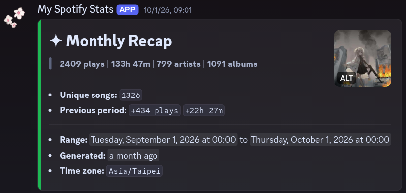
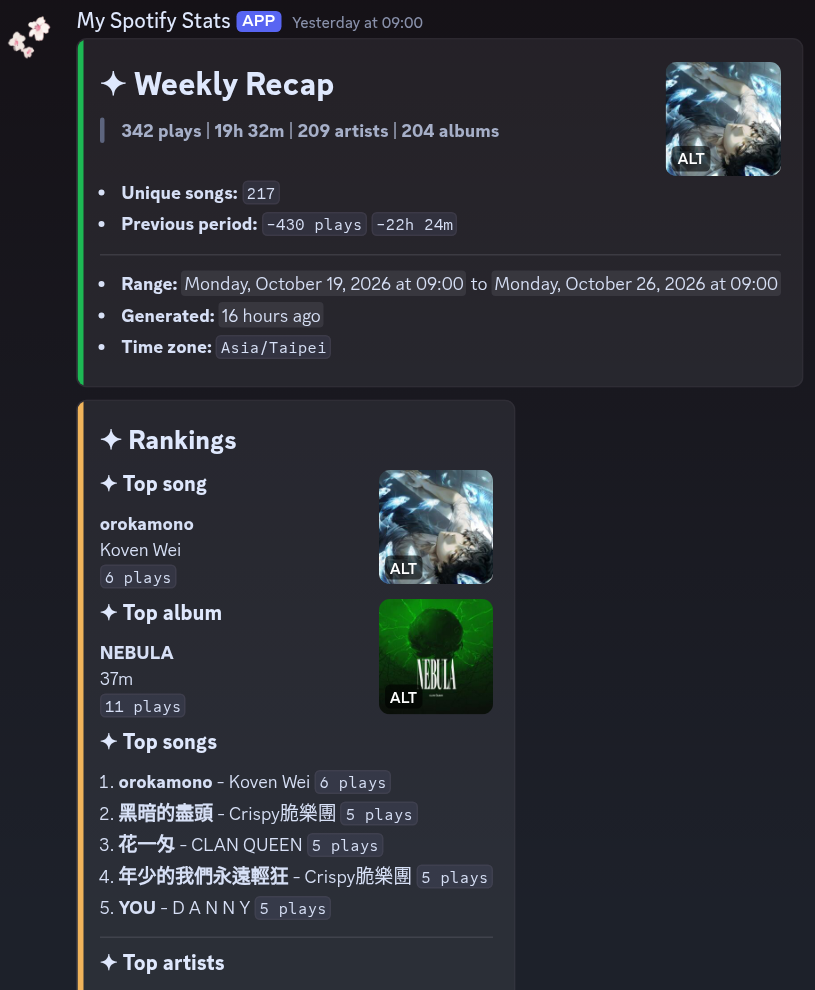
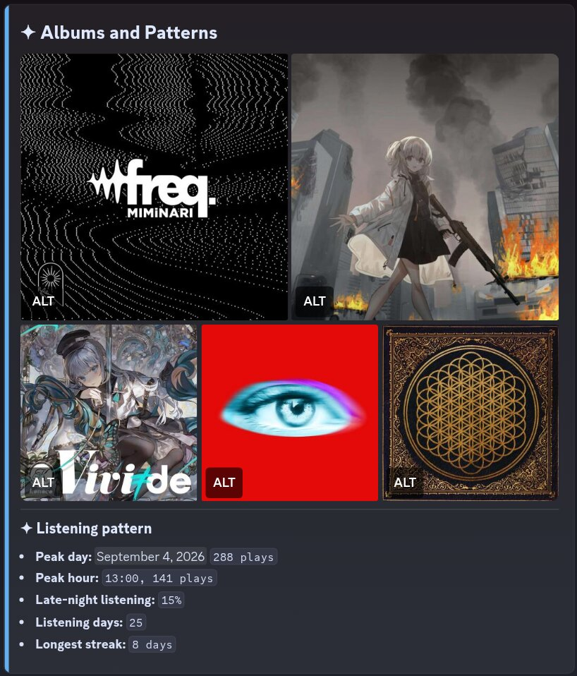

不想收回顧的話，在 admin 頁取消勾選 **自動發送週報 / 月報 DM**，再按 **只儲存**。

## 匯入完整的 Spotify 歷史（選用）

Spotify 可以把你所有的播放紀錄寄給你：

1. 到 [Spotify 隱私設定](https://www.spotify.com/account/privacy/) 申請
   **Extended streaming history**（延伸串流紀錄）。Spotify 會用 email 寄給你，
   通常幾天內，最久 30 天。
2. 解壓縮下載的檔案。
3. 先備份資料庫，試跑一次確認沒問題（不會寫入任何東西），再正式匯入。
   資料夾路徑要加上引號；可以直接把資料夾拖進終端機視窗，路徑就會自動貼上。

   ```bash
   npm run cf:d1:backup:remote
   npm run cf:import -- --remote --dry-run "/路徑/Spotify Extended Streaming History"
   npm run cf:import -- --remote "/路徑/Spotify Extended Streaming History"
   ```

4. 回到 admin 頁按 **立即同步**，更新統計數字。

匯入會略過你第一首同步歌曲之後的所有紀錄，所以 Worker 已經存過的歌不會重複計算；
同一份資料再匯入一次也不會多加。比較短的「Account data」匯出檔也能用，只是細節比較少。
要撤銷一次匯入，請看 [docs/backup-rollback-and-import.md](docs/backup-rollback-and-import.md)（英文）。

## 常見問題

<details>
<summary><b>在 Spotify Developer Dashboard 找不到 Create app</b></summary>

- **不是 Premium。** 從 2026 年 2 月起，免費的 Spotify 帳號不能建立開發者 app。
  這時頁面只會寫「You haven't created any apps yet」，完全沒有按鈕。
- **你是 Premium Duo 或家庭方案的成員。** 有使用者回報，這裡只有付款的方案管理者帳號算 Premium，
  成員帳號會看到一樣空白的頁面。請方案管理者來建立 app（見下面的變通方法）。
- **email 還沒驗證。** 頁面上會寫「You need to verify your email address before you can create an app」。
  請先驗證 Spotify 帳號的 email。如果你是用 Google、Facebook 或 Apple 登入，可能收不到驗證信，
  要先到[登入方式](https://www.spotify.com/account/login-methods/)加一個「email 和密碼」的登入方式。
- **已經有 app 了。** Spotify 會限制每個人能建立的 app 數量。可以直接拿已經有的 app 來用，
  把這個專案的 Redirect URI 加進去就好。
- 有些 Premium 帳號還是看不到這個按鈕，這是 Spotify 那邊的問題，可以到
  [Spotify for Developers 論壇](https://community.spotify.com/t5/Spotify-for-Developers/bd-p/Spotify_Developer)詢問。

**沒有 Premium 的變通方法**：Spotify 只要求 app 的擁有者有 Premium。有 Premium 的人（朋友，或你的方案管理者）
可以在他的 app 的 **User Management** 加入你的 Spotify email（每個 app 最多 5 人），在 Redirect URIs 加上你的
Worker 網址加 `/spotify/callback`，再把 app 的 Client ID 和 Client Secret 給你。第 6 步連結 Spotify 時，
用你自己的帳號登入（先登出對方的帳號）：Worker 記錄的是你連結的那個帳號，不是 app 擁有者的。
只跟信得過的人這樣做：拿到 Client Secret 的人就能以那個 app 的身分操作，而且擁有者的 Premium 一斷，app 就會停。
</details>

<details>
<summary><b>要花錢嗎？</b></summary>

不用。它在 Cloudflare 的免費方案內就能跑（Workers、Cron Triggers 和 D1）。
唯一的條件是 Spotify Premium，因為 Spotify 規定開發者 app 要有 Premium。
</details>

<details>
<summary><b>需要自己的網域嗎？</b></summary>

不用，免費的 `workers.dev` 網址就能用。想用自己的網域的話，先把網域加到 Cloudflare，
再把 `wrangler.toml` 裡的 `routes` 取消註解。
</details>

<details>
<summary><b>現在還能做新的個人檔案 widget 嗎？</b></summary>

大概不行：Discord 在 2026-07-27 結束了自訂 widget 的實驗，新的 app 拿不到 widget 編輯器，
見最上面的警告。沒有 widget 的話，回顧私訊、統計和 admin 頁都照常能用。
</details>

<details>
<summary><b>朋友可以共用我架好的這套嗎？</b></summary>

不行。一套只會追蹤一個 Spotify 帳號，也只會更新一個 Discord 使用者的個人檔案。
朋友要用的話，得各自架一套，用自己的 Discord app、Spotify app 和 Cloudflare 帳號。
</details>

<details>
<summary><b>widget 會即時顯示我正在聽的歌嗎？</b></summary>

不會。它顯示的是你最近聽完的那首歌，每 10 分鐘檢查一次。Discord 的 widget 本來就不是拿來顯示即時資料的。
</details>

<details>
<summary><b>為什麼聽歌時間跟 Spotify Wrapped 對不上？</b></summary>

Spotify 的最近播放清單只給每首歌的長度，不是你實際聽了多久，所以同步來的聽歌時間是以整首歌計算的。
匯入的歷史紀錄才有精確的播放時間。
</details>

<details>
<summary><b>可以改週報、月報的寄送時間嗎？</b></summary>

可以。修改 [config/app.json](config/app.json) 裡的 `recapReports`，再部署一次：
`weeklyDay`（0 是星期日，1 是星期一，以此類推）、`monthlyDay`、`sendHour` 和 `sendMinute`（要是 10 的倍數）。
時間以台灣時間（UTC+8）計算，時區本身目前還不能改。
</details>

<details>
<summary><b>我的資料誰看得到？</b></summary>

聽歌紀錄存在你自己的 Cloudflare 資料庫裡。admin 頁和管理路由都要用你的管理密碼才能進去。
Spotify 只允許 Worker 讀取你最近播放的歌曲。widget 上顯示的內容，任何打開你 Discord 個人檔案的人都看得到。
</details>

<details>
<summary><b>要怎麼整個移除？</b></summary>

1. 刪掉 Worker 和它的資料庫：

   ```bash
   npx wrangler delete
   npx wrangler d1 delete spotify-discord-stats
   ```

2. 到 [spotify.com/account/apps](https://www.spotify.com/account/apps/) 移除這個 app 的存取權，
   再到 Spotify Developer Dashboard 刪掉 app。
3. 把 widget 從 Discord 個人檔案移除，再到 Discord Developer Portal 刪掉 app。
</details>

## 疑難排解

<details>
<summary><b>Spotify 顯示 <code>INVALID_CLIENT: Invalid redirect URI</code></b></summary>

Spotify 後台的 Redirect URI 和 `wrangler.toml` 裡的 `SPOTIFY_REDIRECT_URI` 必須完全一樣，
包含 `https://`，結尾也不能多一個斜線。改正錯的那一邊；如果改的是 `wrangler.toml`，
再跑一次 `npm run cf:deploy`。
</details>

<details>
<summary><b>同步失敗，出現 <code>Active premium subscription required</code> 或 Spotify 的 403 錯誤</b></summary>

建立 Spotify app 的那個帳號必須有有效的 Premium 訂閱。如果你連結的是另一個 Spotify 帳號，
要先在 Spotify app 設定的 **User Management** 把它加進去。
</details>

<details>
<summary><b>widget 沒有更新，或 admin 頁警告 widget 推送失敗</b></summary>

- 確認 widget 已經加到你的個人檔案（第 7 步），而且 `DISCORD_CLIENT_ID` 是擁有這個 widget
  的 app 的 Application ID。
- 同步後 admin 頁會用黃字顯示失敗原因；聽歌紀錄照樣會存，回顧也照常寄出。

  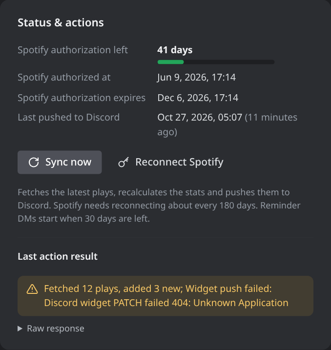

- 如果你的 app 沒有 widget 編輯器，目前就無法使用 widget（見最上面的警告）。
  不想讓 Worker 一直嘗試的話，把 `config/app.json` 裡的 `"patchDiscordOnSync"` 改成 `false`，
  再部署一次。
- 更多說明在 [docs/discord-widget.md](docs/discord-widget.md)（英文）。
</details>

<details>
<summary><b>收不到週報／月報私訊</b></summary>

- 確認 bot 在一個你也在的伺服器裡。
- 在那個伺服器允許成員傳私訊（對伺服器按右鍵 → **隱私設定**）。
- 確認 `DISCORD_USER_ID` 填的是你的使用者 ID，不是 Application ID。
- 確認 bot token 是最新的。在 Developer Portal 重設 token 後舊的就失效了，要再跑一次
  `npx wrangler secret put DISCORD_TOKEN`。
</details>

<details>
<summary><b>admin 頁登入失敗（<code>Token 不正確</code>）</b></summary>

輸入的密碼跟 `ADMIN_TOKEN` 不一樣。忘記的話，用 `npx wrangler secret put ADMIN_TOKEN`
設一組新的。
</details>

## 更新版本

下載新版（或 `git pull`）。如果是下載 ZIP，記得把舊資料夾裡的 `wrangler.toml`
複製到新資料夾。接著執行：

```bash
npm install
npm run cf:d1:migrate:remote
npm run cf:deploy
```

你的機密值、設定和資料都會保留。

## 更多文件

以下文件目前只有英文：

- [Admin 頁](docs/admin-page.md)：所有設定、統計項目和管理路由。
- [Discord 個人檔案 widget](docs/discord-widget.md)：欄位名稱，以及 widget 怎麼被更新。
- [Cloudflare Worker 部署](docs/cloudflare-worker.md)：上面設定步驟的參考版。
- [備份、還原與歷史匯入](docs/backup-rollback-and-import.md)
- [在自己的伺服器上跑](docs/vps-deployment.md)：用 Node.js + SQLite 取代 Cloudflare 的做法，
  不會自動寄週報、月報。
- [Recap 名詞解釋](docs/recap-glossary.md) 和 [ADR 0001](docs/adr/0001-discord-recap-reports.md)：
  週報、月報的設計紀錄。

## 給開發者

專案結構：

- `worker/`：Cloudflare Worker（路由、D1 存取、Spotify、Discord、統計、回顧寄送）。
- `shared/`：不綁執行環境的共用程式（時間、key、播放紀錄解析、統計項目、回顧排版）。
- `src/`：Node.js + SQLite 版本，給本機開發和自架伺服器用。
- `scripts/`：D1 備份和歷史匯入工具。
- `migrations/`：D1 資料表 migration。
- `config/`：預設的 app 和 widget 設定。
- `test/`：Node 測試。

執行測試和語法檢查：

```bash
npm test
find src worker shared scripts test -name '*.js' -print0 | xargs -0 -n 1 node --check
```

要在本機跑 Worker：先把 migration 套到本機資料庫，把機密值（`DISCORD_TOKEN`、
`SPOTIFY_CLIENT_SECRET`、`ADMIN_TOKEN`）以 `NAME=value` 一行一個寫進 `.dev.vars`，再啟動：

```bash
npm run cf:d1:migrate:local
npm run cf:dev
```

Node/SQLite 的指令（`npm run spotify:auth-url`、`spotify:token`、`spotify:sync`、`npm start`）
會讀 `.env`，可以從 [.env.example](.env.example) 複製一份開始。

已知限制：

- admin 頁介面只有繁體中文。
- 週報、月報的排程固定用 `Asia/Taipei`。
- Spotify 的 Recently Played API 只給歌曲長度，不是實際聽了多久，所以同步來的聽歌時間是估計值。
  匯入的歷史紀錄才有精確的播放時間。
- Spotify 的歷史匯出檔不含專輯封面。

## 授權

[MIT](LICENSE)
