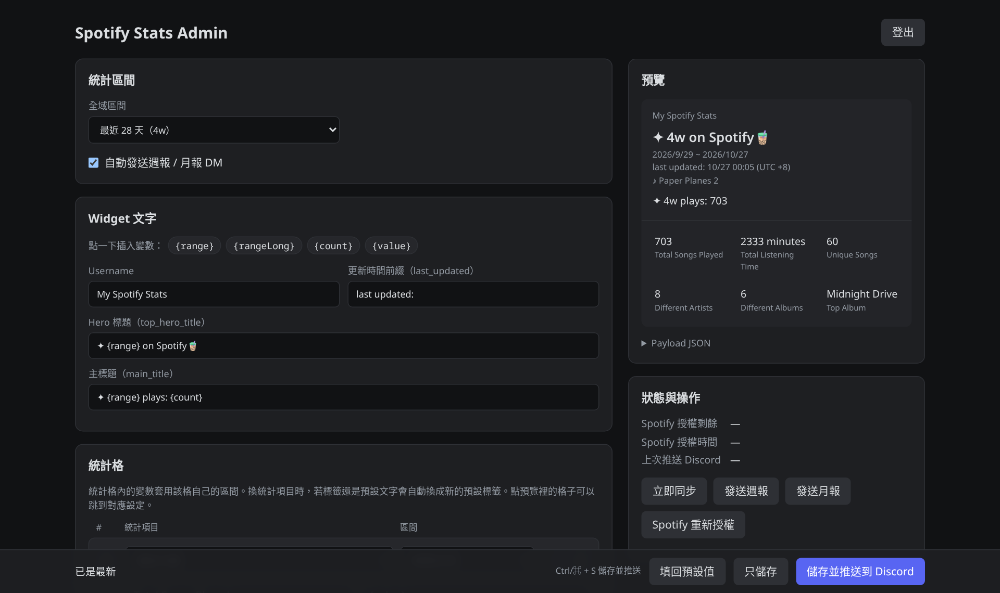

# Admin Page

Open `https://YOUR_WORKER_URL/admin` and sign in with your `ADMIN_TOKEN`.
Settings are saved in the database and take effect without a redeploy.



## Layout and language

The header shows two status pills (days left on the Spotify authorization and
the last push to Discord; click either to open the Status tab), the language
switch, and Log out. Below it, four tabs:

- **Widget**: stats range, widget text and the six stat slots.
- **Hero image** (大圖): the image mode, upload and crop, the size template and
  the widget editor reminder. A yellow dot on the tab means the reminder is
  still open (upload or album mode, not ticked yet).
- **Recaps** (週報月報): the recap DM switch, when recaps are sent, and test
  sends.
- **Status** (狀態): authorization dates, last push, Sync now, Reconnect
  Spotify, and the result and raw response of the last action.

The active tab is kept in the URL hash (`/admin#hero`), so a reload stays on
it. The tabs work with the arrow keys, Home and End.

The live preview stays pinned on the right. Click a part of it to jump to its
setting: the hero title, last-updated line, main title or username focus their
text field, a stat cell opens its slot row, and the hero image opens the Hero
image tab. The date line and the song line are generated, so clicking them
explains that (the dates also jump to the stats range). A Card / JSON toggle
shows the payload instead. Under 900 px wide the preview becomes a panel at the
bottom of the screen; tap it to open or close it.

The save bar at the bottom counts unsaved changes and has 填回預設值 (Reset to
defaults), 只儲存 (Save only) and 儲存並推送到 Discord (Save & push to Discord);
Ctrl/⌘ + S saves and pushes.

The interface is in Traditional Chinese or English. The first visit follows the
browser language (Chinese for any `zh` locale, English otherwise); the
中文 / EN switch in the header (also on the sign-in page) changes it at once
and is remembered in the browser. Only the page is translated: widget text,
default slot labels and recap DMs stay as configured, since Discord shows them.
Error messages come with a `code` from the server so the page can show them in
either language.

## What you can change

- Global stats range: 7 / 28 / 90 / 365 days, a custom number of days, or all
  time.
- Widget copy: username, hero title, main title, last-updated prefix.
- Hero image (the Hero image tab, 大圖; the big Widget Top image, field
  `hero_image`):
  - Fixed asset (固定素材, default): sends nothing, Discord shows the
    `widget_hero` fallback asset.
  - Custom upload (自訂上傳): upload a PNG, JPEG, WebP or GIF (max 1.5 MB,
    1300×1200 fits the template) on the page. The widget points at
    `PUBLIC_BASE_URL/widget/hero?v=<hash>`, so a new upload changes the URL and
    skips Discord's cache. With no image uploaded, or no `PUBLIC_BASE_URL` /
    `SPOTIFY_REDIRECT_URI` to build a public URL, it falls back to the asset.
    Choose & crop an image (選擇圖片並裁切) opens a crop tool in the browser: drag to
    move, slider or mouse wheel to zoom, with guides for the template's
    boundaries area (top 4%), heavy/minor fade zones (left 0–17% / 17–35%)
    and the three subtitle lines. Apply & upload (套用並上傳) uploads exactly
    1300×1200 as PNG, or as WebP (quality 0.92, then 0.85) or JPEG (0.9) when
    the PNG is over 1.5 MB. Cropping turns a GIF into a still image; Upload
    without cropping (不裁切直接上傳) uploads the original file instead. The size template (`docs/images/templates/hero-guide-1300x1200.png`)
    is shown next to the upload box and in the crop tool, with a download link.
  - Last played album cover (最近播放的專輯封面): the Spotify album artwork
    of the last played song. Falls back to the asset when that play has no
    artwork (for example imported history).

  The mode is saved with the other settings; upload and delete take effect
  immediately. The widget editor must use User Data `hero_image` with a
  Fallback, see [discord-widget.md](discord-widget.md#data-field-names).
  The Worker cannot read the widget editor, so in upload and album mode the
  tab shows these steps with a link to the app's widget editor (built
  from `DISCORD_CLIENT_ID`) until you tick "I have set this up in the widget
  editor" (我已經在 widget 編輯器設定好了);
  that tick is saved as `widget.heroEditorConfirmed` and only hides the note.
  The Node/VPS runtime has no admin page or image store: it reads the mode
  from `heroImage` in `config/widget.json`, supports `album`, and treats
  `upload` as `asset`.
- Six stat slots. Each slot picks a metric, a range (follow global, a fixed
  number of days, or all time), a label, and a value format. Slots can be
  reordered.
- Weekly/monthly recap DMs on or off (saved with the other settings). The
  Recaps tab also shows the schedule (weekly on Monday 09:00, monthly on the
  1st at 09:00, `Asia/Taipei`) and sends a test recap after asking to
  confirm.

Text fields accept placeholders: `{range}` (`4w`, `90d`, `all time`),
`{rangeLong}` (`4 Weeks`, `All Time`), `{count}` (songs played), and `{value}`
in slot value formats. Inside a slot, placeholders use that slot's own range.

## Metrics

Defined in [shared/widget-metrics.js](../shared/widget-metrics.js):

| Group | Metrics |
| --- | --- |
| Counts | songs played, unique songs, artists, albums |
| Time | listening minutes, listening hours, daily minutes, daily plays, average track length |
| Top | top song (optionally with artist), top artist, top album, and each one's play count |
| Habits | peak hour, peak weekday, listening days, busiest day, late-night share (00:00–05:00) |
| Discovery | new songs, new artists (first heard in the range), plays per song |
| Streaks | current streak, longest streak |
| Milestone | days since the first stored play |

Genres and skip rates are not offered: artist genres are not stored, and
Recently Played rows carry track length rather than time actually listened.

## How it works

Saved settings live in D1 (`app_state.admin_settings`) and override
[config/app.json](../config/app.json) and
[config/widget.json](../config/widget.json), which stay as the defaults.
Signing in sets a 30-day session cookie signed with `ADMIN_TOKEN`, so changing
the token signs every session out.

Only the queries the chosen slots need are run, once per distinct range.
Results are cached per range and reused until a newer play arrives, the hour
changes, or the slot selection changes. After importing older history, press
Sync now on the Status tab to refresh the cached numbers. The "new artists" metric needs
migration `0004`. Uploaded hero images live in the `widget_images` table from
migration `0005`.

## Admin routes

All of these need `ADMIN_TOKEN`, either signed in through `/admin` or as
`?token=YOUR_ADMIN_TOKEN`:

```text
GET  /admin                        settings page
GET  /spotify/login                connect or reconnect Spotify
GET  /admin/sync                   sync now
GET  /admin/stats                  stats as JSON
POST /admin/recap/weekly/send      send the weekly recap DM now
POST /admin/recap/monthly/send     send last month's recap DM now (add &month=2026-06 for a given month)
```

The recap routes send real Discord DMs; they are not previews.

The page itself uses these JSON routes (signed-in session, same-origin only):

```text
GET  /admin/api/state              settings, defaults, preview payload, metric catalog (zh-TW + English names),
                                   hero image info, album cover URL, discordClientId, recap schedule, status
POST /admin/api/preview            preview payload (and album cover URL) for unsaved settings
POST /admin/api/settings           save settings
POST /admin/api/push               sync and push to Discord now
POST /admin/api/hero-image         upload the hero image (raw body, Content-Type image/png|jpeg|webp|gif, max 1.5 MB)
POST /admin/api/hero-image/delete  delete the uploaded hero image
```

Uploads are checked against the file's magic bytes, so only real PNG, JPEG,
WebP and GIF files are stored.

`status` holds raw values that the page formats in the chosen language:

```json
{
  "spotify": { "authorizedAt": "…", "expiresAt": "…", "daysLeft": 41, "validDays": 180, "remindDays": 30 },
  "discord": { "lastPushedAt": "…" }
}
```

Errors are JSON `{ "error": "<message>", "code": "<code>", "details": [...] }`.
`error` keeps the readable message (upload errors in Traditional Chinese, the
rest in English); `code` is stable (`unauthorized`, `forbidden`,
`invalid_settings`, `image_too_large`, `image_type`, `spotify_not_connected`,
… see `ERROR_CODES` in [worker/lib/http.js](../worker/lib/http.js)); `details`
lists the individual problems for `invalid_settings` and the missing setting
for `missing_config`.

## Public routes

```text
GET  /widget/hero                  the uploaded hero image, no sign-in (Discord fetches it)
GET  /admin/hero-template.png      the 1300×1200 hero size template, no sign-in
GET  /health                       health check
```

`/widget/hero` returns the stored Content-Type with
`Cache-Control: public, max-age=31536000, immutable` and an ETag, or 404 when
nothing is uploaded.

`/admin/hero-template.png` is embedded in the Worker as base64
(`worker/lib/hero-template-data.js`). After changing the PNG in
`docs/images/templates/`, regenerate it with
`node scripts/build-hero-template.js`; a test fails if the two drift apart.
