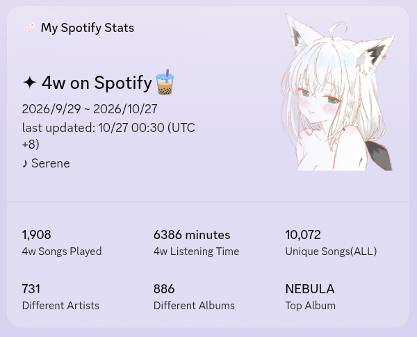
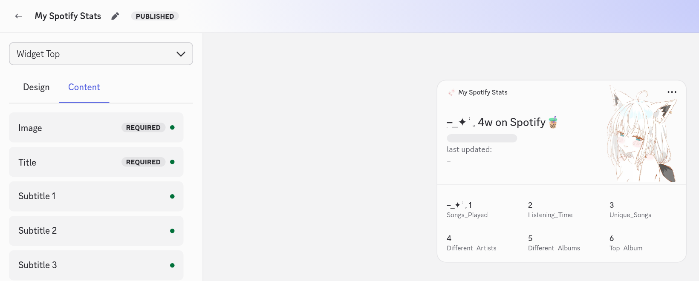

# Discord Profile Widget

The widget is a card on your Discord profile, built in the Developer Portal's
widget editor and filled with data by the Worker.



> [!WARNING]
> Discord ended the custom profile widget experiment on 2026-07-27. New custom
> widgets can no longer be created, and Discord says existing ones "will no
> longer be supported". Widgets made during the experiment still update today,
> but that can stop at any time. Officially, profile widgets are now
> [Game Stats Widgets](https://docs.discord.com/developers/social-layer/game-stats-widgets/overview),
> available to apps with a claimed game.
>
> Sources: Discord's
> [Game Stats Widget Experiment](https://support-dev.discord.com/hc/en-us/articles/42261641635351-Game-Stats-Widget-Experiment)
> support article and
> [discord-api-docs discussion #8527](https://github.com/discord/discord-api-docs/discussions/8527).

## Setting it up

The short version is [Step 7 of the README](../README.md#step-7-set-up-the-profile-widget):
paste [discord-widget-config.json](discord-widget-config.json) into the editor
with **⋮** → **Paste config from clipboard**, upload the three images, save and
publish, then apply the application identity and add the widget to your
profile. The last two steps rely on workarounds from the custom widget
experiment; chloecinders'
[How to Make Discord Widgets](https://chloecinders.com/blog/discord-widgets)
walks through them, including the
[Adding the Widget to your Profile](https://chloecinders.com/blog/discord-widgets#displaying-the-widget-on-your-profile)
section.



The config uses three application assets. Upload images with these names under
**Games** → **Assets**, or choose other images in the editor:

| Asset name | Where it shows |
| --- | --- |
| `widget_hero` | The large picture on the widget (fallback when the Worker sends no `hero_image`) |
| `widget_preview` | The preview picture in Discord's widget picker |
| `widget_mini` | The picture on your mini profile |

Discord's own guide to the editor:
[Widget configuration](https://docs.discord.com/developers/social-layer/game-stats-widgets/widget-configuration).

## Data Field names

To build the widget by hand instead of pasting the config, give every field
that shows live data the Value Type `User Data` with these names (from
[config/widget.json](../config/widget.json) `fields`):

| Surface | Field | Shows |
| --- | --- | --- |
| Widget Top | `top_hero_title` | Title, for example `✦ 4w on Spotify` |
| Widget Top | `during` | Date range of the stats |
| Widget Top | `last_updated` | Last sync time |
| Widget Top | `song` | Last played track, for example `♪ Call of Silence` |
| Widget Top | `hero_image` | The large picture. Set it to Value Type `User Data`, presentation Image, with a Fallback of Application Asset `widget_hero` |
| Mini Profile | `main_title` | Short line, for example `✦ 4w plays: 703` |

The six stats on Widget Bottom each use a value field and a label field. Set
both the stat's Value and its Label to Value Type `User Data`:

| Stat | Value field | Label field |
| --- | --- | --- |
| #1 | `Songs_Played` | `Songs_Played_Label` |
| #2 | `Listening_Time` | `Listening_Time_Label` |
| #3 | `Unique_Songs` | `Unique_Songs_Label` |
| #4 | `Different_Artists` | `Different_Artists_Label` |
| #5 | `Different_Albums` | `Different_Albums_Label` |
| #6 | `Top_Album` | `Top_Album_Label` |

`hero_image` is an image field, not text. The Worker sends it as a media field
(type 3, `{ "url": "https://..." }`) only when the admin page's **Hero image**
tab is set to **Custom upload** or **Last played album cover** and an image is
available. Otherwise it sends nothing and Discord shows the `widget_hero`
fallback. Widgets made from an older copy of the config have `widget_hero` as a
plain Application Asset; switch the hero image to User Data `hero_image` with
that Fallback (or paste the config again) to use the new modes.

These names are fixed slots. What each slot shows is chosen on the
[admin page](admin-page.md), so `Songs_Played` may end up holding a top artist.
Turning on a Label's Fallback in the editor keeps the card readable before the
first sync.

## How the Worker updates the widget

Every sync builds a payload and sends it with the bot token to:

```text
PATCH https://discord.com/api/v9/applications/{DISCORD_CLIENT_ID}/users/{DISCORD_USER_ID}/identities/{DISCORD_IDENTITY_ID}/profile
```

`DISCORD_IDENTITY_ID` defaults to `0`. The payload is only sent when it changed
since the last sync. If the request fails, the sync still saves your plays and
the recap DMs still go out; the admin page shows the error as a warning.

If you don't have a widget, turn widget updates off so the Worker stops calling
the widget API every 10 minutes: set `"patchDiscordOnSync": false` in
[config/app.json](../config/app.json) and deploy again.

If the widget does not change right away, reload the Discord client
(`Ctrl+R`, or `Cmd+R` on macOS).
